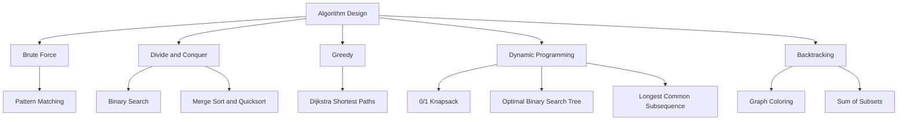

<a id="top"></a>

<div align="center">

# Modern Algorithms & Strategies

### Algorithm design, from handwritten theory to C implementations

A study collection of algorithm notes, implementation documents, and sample outputs.<br>
Explore how problems change when you divide them, reuse solutions, make greedy choices, or backtrack.


[Start learning](#start-learning) · [Algorithm library](#algorithm-library) · [PDF notes](#pdf-notes) · [Run an example](#run-an-example)

</div>

## About the collection

This repository brings together **three units of handwritten PDF notes** and **11 Word documents containing C programs and example output screenshots**. It covers searching, sorting, shortest paths, optimization, constraint solving, and string algorithms.

The notes introduce the ideas, recurrences, and complexity analysis; the implementation documents show how those ideas translate into code. Use the collection for coursework, lab practice, or revision before working through algorithms yourself.

**Start with the PDFs, then open the corresponding implementation document.** The programs are stored inside `.docx` files; there are no standalone `.c` sources or automated build commands in the repository.

## Start learning

1. **Build the foundations.** Read [Unit 1](PDF%20Notes/UNIT1.pdf) for time and space complexity, asymptotic notation, the Master Theorem, and divide and conquer.
2. **Trace searching and sorting.** Compare iterative and recursive binary search, then follow the split and merge steps of merge sort and the partitioning step of quicksort.
3. **Compare optimization strategies.** Read [Unit 2](PDF%20Notes/UNIT2.pdf), then explore Dijkstra's algorithm, 0/1 knapsack, and optimal binary search trees.
4. **Explore a search space.** Read [Unit 3](PDF%20Notes/UNIT3.pdf), then trace graph coloring and sum of subsets to see how backtracking rejects choices.
5. **Work with strings.** Compare exact pattern matching with longest common subsequence: one finds contiguous matches, while the other allows gaps.

For each algorithm, write down the input, the state that changes, the stopping condition, and the time and space costs before running the program.

## The strategy map



| Strategy | Main idea | What to watch while tracing |
| :--- | :--- | :--- |
| **Brute force** | Try candidate positions directly. | Which comparisons repeat, and when a match is complete. |
| **Divide and conquer** | Reduce the problem to smaller instances. | How the range shrinks and how results are combined. |
| **Greedy** | Commit to the next locally optimal choice. | Why that choice is valid under the problem's assumptions. |
| **Dynamic programming** | Store solutions to overlapping subproblems. | The state definition, recurrence, and reconstruction steps. |
| **Backtracking** | Extend a partial solution and reject invalid branches. | Constraints, pruning conditions, and restored state. |

## Algorithm library

Every implementation document is linked below. Each contains C code and example output images.

| Area | Document | What the example demonstrates |
| :--- | :--- | :--- |
| Divide and conquer | [Binary search](Divide%20and%20conquer/binary%20search.docx) | Iterative and recursive variants, with bubble sort preprocessing. |
| Divide and conquer | [Merge sort](Divide%20and%20conquer/merge%20sort.docx) | Recursive splitting and merging into a sorted array. |
| Divide and conquer | [Quicksort](Divide%20and%20conquer/quick%20sort.docx) | Partitioning around the last element, followed by recursive sorting. |
| Greedy | [Dijkstra: distances](Greedy/Djikstra.docx) | Adjacency matrix representation and shortest distances from vertex `0`. |
| Greedy | [Dijkstra: distances and paths](Greedy/Dijkstra%20along%20with%20the%20path.docx) | A chosen source, predecessor tracking, and paths printed from destination back to source. |
| Dynamic programming | [0/1 knapsack](Dynamic%20Programming/knapsack.docx) | A capacity table, maximum profit, and a binary vector of selected items. |
| Dynamic programming | [Optimal binary search tree](Dynamic%20Programming/optimal%20binary%20search%20tree%28OBST%29.docx) | Successful and unsuccessful search weights, plus weight, cost, and root matrices. |
| Backtracking | [Graph coloring](Backtracking/graph%20coloring.docx) | Enumerating valid assignments for a supplied number of colors. |
| Backtracking | [Sum of subsets](Backtracking/sum%20of%20subset.docx) | Include or exclude decisions, pruning, and binary solution vectors. |
| Brute force | [Pattern matching](brute%20force/pattern%20matching.docx) | Direct character comparisons and reported match positions. |
| String algorithms / dynamic programming | [Longest common subsequence](string%20matching/least%20common%20subsequence.docx) | Building a DP table and reconstructing a subsequence and its length. |

**Naming note:** The original filename `least common subsequence.docx` is preserved. Its code solves the **longest common subsequence (LCS)** problem.

## PDF notes

The PDFs are scanned handwritten notes with diagrams, pseudocode, formulas, and complexity summaries.

| Unit | Pages | Topics covered |
| :--- | :---: | :--- |
| [**Unit 1 — Foundations and divide and conquer**](PDF%20Notes/UNIT1.pdf) | 13 | Time and space complexity, step counting, growth rates, asymptotic notation, Master Theorem, divide and conquer, binary search, merge sort, min–max, insertion sort, Strassen's matrix multiplication, and quicksort. |
| [**Unit 2 — Dynamic programming and greedy methods**](PDF%20Notes/UNIT2.pdf) | 4 | Forward and backward approaches, 0/1 knapsack, optimal binary search trees, traveling salesperson, Floyd–Warshall, Bellman–Ford, and complexity summaries for fractional knapsack, Kruskal, Prim, and Dijkstra. |
| [**Unit 3 — Backtracking**](PDF%20Notes/UNIT3.pdf) | 7 | A general backtracking template, Hamiltonian cycles, graph coloring, sum of subsets, knapsack with a bounding function, and N-Queens. |

**Coverage distinction:** Some topics appear only in the PDFs. There are no separate implementation documents for min–max, insertion sort, Strassen, traveling salesperson, Floyd–Warshall, Bellman–Ford, fractional knapsack, Kruskal, Prim, Hamiltonian cycles, or N-Queens.

## Complexity checkpoints

Use these as questions to answer while studying the corresponding examples.

| Algorithm | Time to remember | Detail that matters here |
| :--- | :--- | :--- |
| Binary search | `O(log n)` for the search | Both document variants first use `O(n²)` bubble sort; the complete program therefore takes `O(n²)` time. |
| Merge sort | `O(n log n)` | The merge step uses a temporary buffer. |
| Quicksort | Average `O(n log n)`; worst `O(n²)` | The document uses the last element as pivot; already sorted inputs can produce unbalanced partitions. |
| Dijkstra | `O(V²)` for these matrix implementations | These examples scan vertices directly. They do not use a heap, and require nonnegative edge weights. |
| 0/1 knapsack | `O(nW)` | `W` is the integer capacity, so this is a pseudopolynomial bound. The table also occupies `O(nW)` space. |
| Longest common subsequence | `O(ab)` | `a` and `b` are the string lengths; the stored table also occupies `O(ab)` space. |
| Sum of subsets | Up to `2ⁿ` candidate subsets | Pruning can reduce exploration; printing each solution vector adds output work. |
| Graph coloring | Up to `kᵛ` complete assignments | `k` is the number of colors and `v` the number of vertices; checking constraints and printing solutions add work. |

Complexity depends on the implementation and input assumptions. Treat asymptotic upper, lower, and tight bounds separately from best, average, and worst input cases.

## Run an example

### 1. Get the collection

```bash
git clone https://github.com/sharvilprabhudesai15/Modern-Algorithms-Strategies.git
cd Modern-Algorithms-Strategies
```

Alternatively, choose **Code → Download ZIP** on GitHub. PDFs can be previewed on GitHub; download the Word documents and open them in Microsoft Word, LibreOffice Writer, or another compatible reader.

### 2. Save one program as C source

Open [merge sort.docx](Divide%20and%20conquer/merge%20sort.docx) and copy only its C program into a plain text file named `merge_sort.c`. Exclude the document heading and output image.

Use a C compiler with C99 support for the collection; several examples use variable length arrays. If a document contains multiple programs, such as binary search, save each variant in a separate file.

### 3. Compile and run

With GCC installed on macOS or Linux:

```bash
gcc -std=c99 -Wall -Wextra merge_sort.c -o merge_sort
./merge_sort
```

Enter the sample from the document:

```text
6
8 16 2 5 14 9
```

The sorted output is:

```text
Sorted array is :2 5 8 9 14 16
```

<details>
<summary><strong>Before running the other archived examples</strong></summary>

These are study examples with fixed buffers and limited input validation. Review the copied source and its assumptions before experimenting:

- **Graph coloring:** remove the stray `.` after `nextValue(k);` in the document's code.
- **Dijkstra:** initialize the adjacency matrix before reading edges and handle unreachable vertices. The examples use `0` to represent a missing edge, so zero weight edges need a different representation.
- **Pattern matching:** replace the obsolete `gets` calls with bounded input, and review the final candidate position and recursive indexing before relying on the reported matches.
- **Sum of subsets:** review the positive, sorted weight assumptions behind pruning, and guard accesses to `w[k+1]` at the end of the array.
- **All examples:** check array capacities, node indexing, and compiler diagnostics when choosing inputs.

</details>

## Repository structure

```text
Modern-Algorithms-Strategies/
├── Backtracking/
│   ├── graph coloring.docx
│   └── sum of subset.docx
├── Divide and conquer/
│   ├── binary search.docx
│   ├── merge sort.docx
│   └── quick sort.docx
├── Dynamic Programming/
│   ├── knapsack.docx
│   └── optimal binary search tree(OBST).docx
├── Greedy/
│   ├── Dijkstra along with the path.docx
│   └── Djikstra.docx
├── PDF Notes/
│   ├── UNIT1.pdf
│   ├── UNIT2.pdf
│   └── UNIT3.pdf
├── brute force/
│   └── pattern matching.docx
├── string matching/
│   └── least common subsequence.docx
└── README.md
```

## Contributing

Corrections to the notes, clearer explanations, improved sample inputs, and standalone C implementations are welcome. When proposing a change, identify the algorithm, explain the correction, and include a small example showing the expected behavior.

No license file is currently included in this repository.

---

<div align="center">

Maintained by [**Sharvil Prabhudesai**](https://github.com/sharvilprabhudesai15)

[Back to top ↑](#top)

</div>
